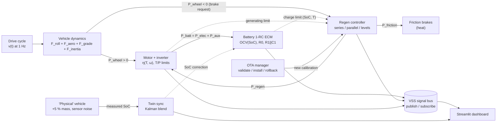
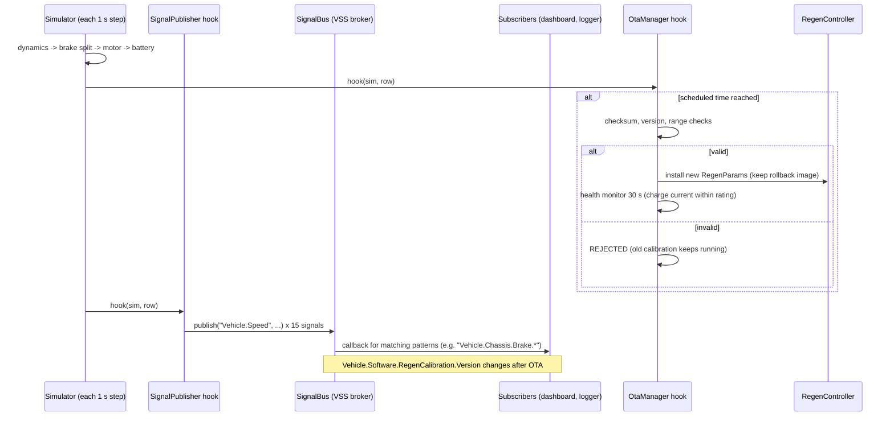

# EV Energy-Recovery Digital Twin

**Simulating Battery State-of-Charge (SoC) Change with Regenerative Braking vs. Conventional Friction Braking over Standard Drive Cycles**

*Course project: Software Defined Vehicles (SDV)*

---

## Table of contents

1. [Problem statement](#1-problem-statement)
2. [Objectives](#2-objectives)
3. [Scope and assumptions](#3-scope-and-assumptions)
4. [Why this is a Software-Defined-Vehicle project](#4-why-this-is-a-software-defined-vehicle-project)
5. [System architecture](#5-system-architecture)
6. [Project structure](#6-project-structure)
7. [Installation and running](#7-installation-and-running)
8. [Drive cycles](#8-drive-cycles)
9. [Equations, every symbol explained](#9-equations-every-symbol-explained)
10. [Regen strategies](#10-regen-strategies)
11. [SDV layer: signals, OTA, twin sync](#11-sdv-layer-signals-ota-twin-sync)
12. [Dashboard guide](#12-dashboard-guide)
13. [Tests](#13-tests)
14. [Sanity check](#14-sanity-check)
15. [Sample output (WLTP, default settings)](#15-sample-output-wltp-default-settings)
16. [Results discussion template](#16-results-discussion-template)
17. [Limitations and future scope](#17-limitations-and-future-scope)
18. [5-minute live demo script](#18-5-minute-live-demo-script)
19. [15 likely viva questions with model answers](#19-15-likely-viva-questions-with-model-answers)
20. [Memory aids and mnemonics](#20-memory-aids-and-mnemonics)
21. [Presentation outline (12 slides)](#21-presentation-outline-12-slides)
22. [References](#22-references)

---

## 1. Problem statement

When a conventional car brakes, its kinetic energy (the energy of motion) is turned into **heat** in the brake pads and discs, and that energy is gone for good. An electric vehicle (EV) can run its traction motor **backwards as a generator**. This puts part of that energy back into the battery, which is called **regenerative braking** ("regen").

How much energy regen recovers is not a fixed number. It depends on:

- the **driving pattern** (stop-and-go city traffic vs. steady highway driving),
- the **motor** (how much generating torque and power it can handle),
- the **battery** (a full or cold battery cannot accept much charge),
- the **software strategy** that decides how braking is split between the motor and the friction brakes.

This project builds a **software digital twin** of a compact EV. The twin answers this question:

> *On the same standard drive cycle, how much higher is the battery SoC at the end with regenerative braking than with friction-only braking, and what limits the recovery?*

## 2. Objectives

1. Simulate an EV second by second over standard drive cycles (WLTP, NEDC, UDDS, MIDC and a custom city cycle).
2. Model battery SoC, current, voltage and energy flow with a 1-RC equivalent-circuit battery.
3. Compare **friction-only braking** with **regenerative braking plus brake blending** on the same cycle.
4. Implement three regen strategies (series, parallel, regen levels) and the three physical limits (motor, battery, strategy), plus low-speed fade.
5. Add an **SDV layer**: COVESA VSS-style signals on a publish/subscribe bus, a simulated **OTA calibration update** with validation and rollback, and **twin-vs-physical synchronisation** with error metrics.
6. Present everything on an interactive **Streamlit dashboard** for a live class demo.
7. Check the model with automated **pytest** tests and a **sanity check** against realistic ranges.

## 3. Scope and assumptions

**In scope:** longitudinal (straight-line) vehicle energy, the motor/inverter, the battery, brake blending, SoC, and the SDV software layer.

**Out of scope:** lateral dynamics (cornering), tyre slip, ABS/ESC interaction with regen, battery thermal dynamics (temperature is held constant), battery ageing, and the driver model (the car follows the speed trace exactly).

### Vehicle parameters (ALL ASSUMED, similar in class to a Tata Nexon EV, not official data)

| Parameter | Symbol | Value | Where |
|---|---|---|---|
| Curb mass + driver | m | 1400 + 75 kg | `vehicle.curb_mass_kg`, `driver_mass_kg` |
| Rotational mass factor | δ | 1.05 | `rotational_mass_factor` |
| Drag coefficient | C_d | 0.33 | `drag_coefficient` |
| Frontal area | A | 2.3 m² | `frontal_area_m2` |
| Rolling-resistance coefficient | C_rr | 0.010 | `rolling_resistance_coeff` |
| Wheel radius | r | 0.32 m | `wheel_radius_m` |
| Gear ratio | G | 9.0 | `gear_ratio` |
| Drivetrain efficiency | η_d | 0.97 | `drivetrain_efficiency` |
| Auxiliary load (HVAC, 12 V) | P_aux | 400 W | `aux_power_w` |
| Motor peak power / torque | P_peak, T_peak | 105 kW / 250 N·m | `motor.*` |
| Battery | E, V_nom | 30 kWh, 320 V (NMC, 87 cells in series) | `battery.*` |
| Battery resistances | R0, R1, C1 | 0.09 Ω, 0.04 Ω, 2000 F | `battery.*` |
| Max charge (regen) power | P_chg | 45 kW | `max_charge_power_kw` |
| Charge (coulombic) efficiency | η_c | 0.98 | `charge_efficiency` |
| Regen fade | v_start → v_end | 10 → 5 km/h | `regen.fade_*` |

All values live in [`config/vehicle_default.json`](config/vehicle_default.json). Change them there; no code changes are needed.

**Other modelling assumptions**

- Time step Δt = 1 s, the same resolution as the drive-cycle data.
- The vehicle follows the speed trace exactly. If the motor cannot supply enough power, the shortfall is flagged as a "trace miss".
- Battery temperature equals ambient temperature and stays constant during the drive.
- Friction-only baseline: the motor still drives the car, but **all** braking is done by the friction brakes.
- Range estimate = usable energy (92 % of 30 kWh) ÷ Wh/km on that cycle.

## 4. Why this is a Software-Defined-Vehicle project

In a **software-defined vehicle**, the vehicle's behaviour is set mainly by **software that can be changed after the car is sold**, not by fixed hardware. Regenerative braking is a strong example of this. The motor, battery and brakes are the same in every car, but **how much energy is recovered is decided entirely by a software calibration** (strategy, regen level, fade speed, blending ratio).

This project shows the four key ideas of SDV:

| SDV idea | Where in this project |
|---|---|
| **Hardware abstraction through standard signals** | `sdv/signals.py` publishes every value as a named, typed COVESA VSS signal (e.g. `Vehicle.Powertrain.TractionBattery.StateOfCharge.Current`) on a publish/subscribe bus, just like Eclipse Kuksa.val in a real car. Apps subscribe to names, not CAN IDs. |
| **Over-the-air (OTA) updates** | `sdv/ota_update.py` changes the regen calibration **during the drive**, with a checksum, a version check, safety-range validation, a health monitor and rollback. |
| **Digital twin** | `sdv/twin_sync.py` runs a cloud-side model alongside a "physical" car, compares the two (RMSE) and corrects the twin with measurements. |
| **Feature as software** | The same car gets "Low", "High" or "One-pedal" regen by changing a parameter, which is how real EVs sell and update features. |

## 5. System architecture

### 5.1 Block diagram



### 5.2 Data flow of the signal bus and the OTA path



### 5.3 What happens in one time step

1. Read speeds v_k and v_k+1 from the cycle and compute the average speed and acceleration.
2. Compute the four road-load forces and P_wheel.
3. If P_wheel ≥ 0 (traction): P_elec = P_wheel / (η_d · η_m).
4. If P_wheel < 0 (braking): the controller splits the brake request into regen and friction, and P_elec = −P_regen · η_d · η_m.
5. Compute the battery power P_batt = P_elec + P_aux, then the battery step gives current, voltage, SoC and losses.
6. Run the hooks: the OTA manager, the twin corrector and the VSS publisher.

## 6. Project structure

```
ev_regen_twin/
├── app.py                       Streamlit dashboard (6 tabs, KPI cards, export)
├── run_cli.py                   Command-line runner: KPIs + sanity check
├── config/vehicle_default.json  All vehicle, battery, regen, OTA and twin parameters
├── core/
│   ├── __init__.py              load_config()
│   ├── drive_cycles.py          WLTP / NEDC / UDDS / MIDC / city cycles, CSV upload
│   ├── vehicle_dynamics.py      Road-load forces and wheel power
│   ├── motor_model.py           Motor + inverter limits and efficiency map
│   ├── battery_model.py         1-RC Thevenin battery, SoC, charge limits
│   ├── regen_controller.py      Brake blending strategies and limits
│   ├── simulator.py             Time-step loop with hooks
│   └── analysis.py              Energy totals, KPIs, braking events, sanity check
├── sdv/
│   ├── signals.py               VSS catalogue + publish/subscribe SignalBus
│   ├── ota_update.py            OTA packages, validator, install, rollback
│   └── twin_sync.py             Physical stream vs twin, RMSE, Kalman correction
├── data/                        Drive-cycle CSVs (time_s, speed_kmh)
├── exports/                     CSV + PNG files written by "Export results"
├── tests/                       pytest tests (67 tests)
├── requirements.txt
└── README.md
```

## 7. Installation and running

**Requirements:** Python 3.10 or newer. No paid APIs and no hardware are needed.

### Windows (PowerShell)

```bash
cd ev_regen_twin
python -m venv .venv
.venv\Scripts\activate
pip install -r requirements.txt
streamlit run app.py
```

### Linux / macOS

```bash
cd ev_regen_twin
python3 -m venv .venv
source .venv/bin/activate
pip install -r requirements.txt
streamlit run app.py
```

The browser opens at `http://localhost:8501`.

### Other commands

```bash
python run_cli.py                                   # WLTP, default settings
python run_cli.py --all                             # every cycle
python run_cli.py --cycle MIDC --strategy levels --level Medium
python run_cli.py --cycle UDDS --soc 100 --temp 0   # full, cold battery
python -m core.drive_cycles                         # regenerate data/*.csv
python -m pytest -v                                 # run all tests
```

**[Insert screenshot: terminal showing `pip install` finishing and `streamlit run app.py` printing the local URL]**

**[Insert screenshot: dashboard home page with the sidebar and KPI cards]**

### Uploading your own drive cycle

Choose **"Upload my own CSV…"** in the sidebar. The file needs a time column (seconds) and a speed column (km/h). The column names are detected automatically if they contain "time" and "speed". If the speed header contains `m/s`, the values are converted to km/h. Data is resampled to 1 s. Example:

```
time_s,speed_kmh
0,0
1,3.5
2,7.2
```

## 8. Drive cycles

| Key | Cycle | Duration | Distance | Max speed | Mean speed | Stops | Exact? |
|---|---|---|---|---|---|---|---|
| WLTP | WLTC Class 3b | 1800 s | 23.27 km | 131.3 km/h | 46.5 km/h | 11 | **Approximation** |
| NEDC | 4 × ECE-15 + EUDC | 1180 s | 10.80 km | 120.0 km/h | 32.9 km/h | 13 | Exact segments |
| UDDS | US EPA UDDS (FTP-72) | 1369 s | 11.99 km | 91.2 km/h | 31.5 km/h | 16 | **Approximation** |
| MIDC | Indian Modified Indian Driving Cycle | 1180 s | 10.33 km | 90.0 km/h | 31.5 km/h | 13 | **Approximation** |
| CITY | Custom city stop-and-go | 600 s | 2.48 km | 40.0 km/h | 14.9 km/h | 18 | Custom (exact by definition) |

**Approximations, stated clearly:**

- **NEDC** is built from the published regulation segment table (constant accelerations, cruises and idles), so its shape is exact.
- **WLTP** is built from micro-trips for each of its four phases (Low, Medium, High, Extra-High). Each phase is then *shape-fitted* with the transform v' = v_max·(v/v_max)^p, where p is found by bisection. This makes each phase's **duration, maximum speed and distance match the published values exactly**. The second-by-second wiggles of the official trace are **not** reproduced.
- **UDDS** uses the same method: 1369 s, 11.99 km (7.45 mi) and 91.2 km/h max are matched exactly, but the micro-trips differ from the official trace.
- **MIDC** is approximated as 4 × ECE-15 plus the EUDC variant for low-powered vehicles (top speed 90 km/h), as used in Indian type approval.
- For official traces, download them (UNECE GTR 15, US EPA dynamometer schedules, ARAI) and use the CSV upload.

## 9. Equations, every symbol explained

### 9.1 Vehicle dynamics ([core/vehicle_dynamics.py](core/vehicle_dynamics.py))

$$F_{total} = F_{rolling} + F_{aero} + F_{grade} + F_{inertia}$$

| Force | Equation | Plain-words meaning |
|---|---|---|
| Rolling resistance | $F_{rolling} = m\,g\,C_{rr}\cos\theta$ | Energy lost as tyres squash and un-squash while rolling |
| Aerodynamic drag | $F_{aero} = \tfrac12\,\rho\,C_d\,A\,v^2$ | Pushing air out of the way. It grows with the **square** of speed, so it matters most on highways |
| Grade (slope) | $F_{grade} = m\,g\sin\theta$ | Lifting the car uphill (negative downhill) |
| Inertia | $F_{inertia} = m\,\delta\,a$ | Force needed to speed up (negative when slowing down) |

$$P_{wheel} = F_{total}\cdot v$$

| Symbol | Meaning | Unit |
|---|---|---|
| m | total vehicle mass (car + driver + payload) | kg |
| g | gravitational acceleration, 9.81 | m/s² |
| C_rr | rolling-resistance coefficient | – |
| θ | road angle, θ = atan(grade % / 100) | rad |
| ρ | air density, 1.2 | kg/m³ |
| C_d | drag coefficient (how "slippery" the shape is) | – |
| A | frontal area | m² |
| v | vehicle speed | m/s |
| a | acceleration | m/s² |
| δ | rotational mass factor: extra "apparent mass" from spinning wheels, gears and rotor (≈ 1.05) | – |
| P_wheel | power at the wheels. **> 0: the motor must push; < 0: the car must be braked** | W |

**Discretisation:** for the step from t_k to t_k+1 we use v = (v_k + v_k+1)/2 and a = (v_k+1 − v_k)/Δt. With this choice, F_inertia·v·Δt = ½·m·δ·(v_k+1² − v_k²) **exactly**, so kinetic energy is conserved perfectly (this is tested).

### 9.2 Motor and inverter ([core/motor_model.py](core/motor_model.py))

| Equation | Meaning |
|---|---|
| $\omega_m = \dfrac{v}{r}\,G$ | Motor speed from vehicle speed (r = wheel radius, G = gear ratio) |
| $T_m = \dfrac{F\,r}{G}$ | Motor torque from wheel force |
| $T_{max}(\omega) = \min\!\left(T_{peak}, \dfrac{P_{peak}}{\omega}\right)$ | Constant torque at low speed, constant power at high speed. The same limit applies to generating |
| $P_{loss} = k_c T^2 + k_i\,\omega + k_w\,\omega^3 + P_0$ | Copper (I²R) + iron + windage + constant inverter losses |
| $\eta_{motoring} = \dfrac{P_{mech}}{P_{mech}+P_{loss}}$, $\eta_{generating} = \dfrac{P_{mech}-P_{loss}}{P_{mech}}$ | Efficiency map (clipped to 0.55–0.97) |
| Motoring: $P_{batt} = \dfrac{P_{wheel}}{\eta_d\,\eta_m}$ | Battery must supply **more** than the wheels receive |
| Generating: $P_{batt} = P_{wheel}\,\eta_d\,\eta_m$ | Battery receives **less** than the wheels give up |

η_d = drivetrain (gearbox) efficiency, η_m = motor + inverter efficiency at the current torque and speed. The dashboard's Energy tab plots the efficiency map with the actual operating points.

### 9.3 Battery: 1-RC Thevenin equivalent circuit ([core/battery_model.py](core/battery_model.py))

```
   OCV ──R0──┬──R1──┬── V (terminal)
             └──C1──┘
```

| Equation | Meaning |
|---|---|
| $V = OCV(SoC) - I\,R_0 - V_1$ | Terminal voltage sags under load (I > 0 = discharge) |
| $\dfrac{dV_1}{dt} = -\dfrac{V_1}{R_1C_1} + \dfrac{I}{C_1}$ | Slow "polarisation" voltage of the RC branch |
| $V_1^{k+1} = V_1^k e^{-\Delta t/\tau} + R_1 I (1-e^{-\Delta t/\tau})$, $\tau = R_1C_1$ | Exact discrete update |
| $I = \dfrac{(OCV - V_1) - \sqrt{(OCV-V_1)^2 - 4R_0P}}{2R_0}$ | Current needed for a requested power P (from P = V·I) |
| $SoC_{k+1} = SoC_k - \dfrac{I\,\Delta t}{3600\,Q_{Ah}}$ (discharge) | Coulomb counting |
| $SoC_{k+1} = SoC_k - \dfrac{\eta_c\,I\,\Delta t}{3600\,Q_{Ah}}$ (charge, I < 0) | Some charge is lost while charging |
| $P_{loss} = I^2R_0 + V_1 I$ | Heat in R0 plus energy into the RC branch |
| $R_0(T) = R_{0,25}\,e^{k(25-T)}$ | Resistance rises in the cold |
| $P_{chg,max} = P_{rated}\cdot f_{SoC}(SoC)\cdot f_T(T)$ | **Charge acceptance**: f_SoC = 1 up to 90 %, 0.35 at 95 %, 0.02 at 98 %, 0 at 100 %; f_T derates below 15 °C and above 40 °C |

| Symbol | Meaning |
|---|---|
| OCV | open-circuit voltage, from a lookup curve (NMC or LFP) × number of cells in series |
| R0 | instant ohmic resistance |
| R1, C1 | resistance and capacitance of the slow polarisation branch |
| Q_Ah | capacity in ampere-hours = 30 000 Wh / 320 V = 93.75 Ah |
| η_c | coulombic (charge) efficiency, 0.98 |

### 9.4 Regen controller ([core/regen_controller.py](core/regen_controller.py))

$$P_{brake,req} = -P_{wheel}\quad(\text{only when }P_{wheel}<0)$$

$$P_{regen} = f_{fade}(v)\cdot\min\big(P_{brake,req},\;P_{motor},\;P_{battery},\;P_{strategy}\big)$$

$$P_{friction} = P_{brake,req} - P_{regen}$$

$$f_{fade}(v) = \begin{cases}0 & v \le v_{end}\\ \dfrac{v-v_{end}}{v_{start}-v_{end}} & v_{end}<v<v_{start}\\ 1 & v\ge v_{start}\end{cases}$$

| Symbol | Meaning |
|---|---|
| P_motor | motor generating limit, referred to the wheel: P_max(ω)/η_d |
| P_battery | battery charge limit, referred to the wheel: P_chg,max/(η_d·η_m) |
| P_strategy | limit set by software: max regen power cap, × parallel share, or m·a_max·v for a regen level |
| f_fade | low-speed fade factor. At very low speed the motor's back-EMF is too small to generate usefully, so friction brakes finish the stop |

The controller also records **why** regen was limited: "Motor limit", "SoC limit", "Temperature derate", "Battery power limit", "Strategy limit" or "Low-speed fade".

### 9.5 KPIs ([core/analysis.py](core/analysis.py))

| KPI | Formula |
|---|---|
| Energy | E = Σ P·Δt / 3600 (Wh) |
| Net battery energy | Σ P_batt·Δt (terminal) |
| Energy recovered | Σ P_regen,batt·Δt |
| Recovery efficiency | E_recovered / E_brake,request × 100 % |
| Regen share | E_recovered / E_motor,in × 100 % (share of traction energy) |
| Consumption | Wh/km = E_net / distance |
| Range | 0.92 × 30 kWh × 1000 / (Wh/km) |
| Range gain | range_regen / range_friction − 1 |
| Brake-pad wear proxy | E_friction (friction-only) − E_friction (regen) |

### 9.6 Twin synchronisation (scalar Kalman filter) ([sdv/twin_sync.py](sdv/twin_sync.py))

| Step | Equation | Meaning |
|---|---|---|
| Predict | $P \leftarrow P + Q\,\Delta t$ | While we only use the model, our uncertainty grows |
| Gain | $K = \dfrac{P}{P+R}$ | Trust the sensor more when our uncertainty P is large compared with sensor noise R |
| Update | $SoC \leftarrow SoC + K\,(z - SoC)$ | Move toward the measurement z |
| Shrink | $P \leftarrow (1-K)\,P$ | After using a measurement we are more certain |
| Error | $RMSE = \sqrt{\tfrac1N\sum (SoC_{twin}-SoC_{true})^2}$ | Average size of the twin's error |

## 10. Regen strategies

| Strategy | How it splits braking | Real-world analogue |
|---|---|---|
| **friction_only** | 0 % regen (baseline) | Conventional car |
| **series** ("regen-first") | Motor takes everything it can; friction only tops up | Brake-by-wire EVs (e.g. electro-hydraulic boosters) |
| **parallel** | Motor takes a fixed share (default 30 %) of every brake request | Early hybrids and simple hydraulic systems |
| **levels** | Regen deceleration capped at Off 0 / Low 0.5 / Medium 1.0 / High 1.6 / One-pedal 2.5 m/s². One-pedal also fades later (6 → 2 km/h) | Paddle-shifter regen levels and one-pedal driving |

Because the car must follow the speed trace, a weaker strategy does **not** change how the car slows down. It only changes **how much of the braking is done by the friction brakes** instead of the motor.

## 11. SDV layer: signals, OTA, twin sync

### 11.1 VSS signals ([sdv/signals.py](sdv/signals.py))

| VSS path | Unit | Standard / custom |
|---|---|---|
| Vehicle.Speed | km/h | VSS standard |
| Vehicle.TraveledDistance | km | VSS standard |
| Vehicle.Acceleration.Longitudinal | m/s² | VSS standard |
| Vehicle.Powertrain.TractionBattery.StateOfCharge.Current | % | VSS standard |
| Vehicle.Powertrain.TractionBattery.CurrentCurrent | A | VSS standard (+ = into battery) |
| Vehicle.Powertrain.TractionBattery.CurrentVoltage | V | VSS standard |
| Vehicle.Powertrain.TractionBattery.CurrentPower | W | VSS standard (+ = into battery) |
| Vehicle.Powertrain.TractionBattery.Temperature.Average | °C | VSS standard |
| Vehicle.Powertrain.TractionMotor.Speed | rpm | VSS standard |
| Vehicle.Powertrain.TractionMotor.Torque | N·m | VSS standard |
| Vehicle.Chassis.Brake.RegenPower | W | **CUSTOM extension** |
| Vehicle.Chassis.Brake.FrictionPower | W | **CUSTOM extension** |
| Vehicle.Chassis.Brake.RegenLimitReason | – | **CUSTOM extension** |
| Vehicle.Powertrain.TractionBattery.EnergyRegenerated | Wh | **CUSTOM extension** |
| Vehicle.Software.RegenCalibration.Version | – | **CUSTOM extension** |

`SignalBus` is a small in-memory broker. `publish(path, value, t)` stores the value and notifies subscribers. `subscribe("Vehicle.Chassis.Brake.*", callback)` accepts wildcards. `latest(path)` returns the last value. Unknown signal names are rejected, the same way a real broker rejects paths that are not in its VSS tree.

### 11.2 OTA update ([sdv/ota_update.py](sdv/ota_update.py))

`SCHEDULED → VALIDATING → INSTALLED → HEALTH_OK`, or `→ REJECTED`, or later `→ ROLLED_BACK`

Validation checks:

1. **Integrity:** the SHA-256 checksum of the payload must match (detects tampering or corruption).
2. **Version:** the new version must be newer than the running one (no silent downgrade).
3. **Whitelist:** only the regen calibration keys can be changed (strategy, parallel_ratio, regen_level, fade speeds, max regen power).
4. **Safety ranges:** e.g. parallel_ratio 0–1, fade_end 0–20 km/h, max regen power 0–105 kW, regen deceleration ≤ 3 m/s² (≈ 0.3 g, so the rear axle does not lock).
5. **Cross-checks:** fade_end must be lower than fade_start.

After installation, a 30 s **health monitor** checks that the charge current stays within the pack rating. If it does not, the update is rolled back automatically. A manual rollback can also be scheduled.

### 11.3 Twin synchronisation ([sdv/twin_sync.py](sdv/twin_sync.py))

| Actor | What it is |
|---|---|
| Physical vehicle | Same model with **hidden** differences: +5 % mass, +10 % R0. Sensors add noise: SoC σ 0.3 %, current σ 1.5 A, voltage σ 0.5 V |
| Twin, open loop | Nominal model, started with a 2 % SoC error. It never looks at the car |
| Twin, corrected | Nominal model plus a measurement update every 10 s (Kalman blend or hard re-sync) |

Result on WLTP: open-loop RMSE **2.09 %**, Kalman-corrected **0.17 %**, raw sensor **0.30 %**. The corrected twin is **more accurate than the sensor itself**, because it combines the physics model with the measurements. **This feedback loop is what makes it a digital *twin* and not just a simulation.** A simulation predicts a generic car; a twin tracks one particular car.

## 12. Dashboard guide

**Sidebar:** drive cycle (or CSV upload), number of repeats, initial SoC, ambient temperature, payload, road grade, regen strategy and level, advanced calibration (fade speeds, max regen power), OTA update (time, new calibration, an "inject unsafe values" demo option, rollback), and the twin-sync method.

**KPI cards:** final SoC for both cases, kWh consumed, kWh recovered, recovery efficiency, Wh/km, range for both cases, range gain, and friction-brake energy saved. Below them is an expandable sanity-check panel.

| Tab | Content |
|---|---|
| 🚗 Live Twin | Animated speed gauge, SoC gauge and power-flow gauge (Battery → Motor / Motor → Battery), plus a live VSS signal table, with play/pause, a time slider and a playback-speed slider. Also a trip overview chart and signal-bus statistics with a snapshot at any time |
| 📉 SoC Comparison | SoC with regen vs friction-only (braking events shaded), ΔSoC, speed, and cumulative recovered energy vs brake heat |
| ⚡ Energy Breakdown | Sankey diagram (battery → motor → wheels → aero/rolling/brake heat/recovered), grouped bar chart, pie chart of lost braking energy by reason, and the motor efficiency map with operating points |
| 🛑 Braking Events | Table of every braking event: duration, kinetic energy, recovered Wh, recovery %, and what limited regen |
| 📡 OTA & Twin Sync | OTA event log, parameter diff, SoC with vs without OTA, version timeline; twin vs physical SoC, error plot and RMSE metrics |
| 📘 Theory | Block diagram, all equations, and the VSS catalogue |

**💾 Export results** saves `exports/results_<cycle>_<time>.csv` (full time series of both cases) and `exports/charts_<cycle>_<time>.png` (a 4-panel summary), and offers both as downloads.

**[Insert screenshot: Live Twin tab during playback, showing a regen event with the green "Motor → Battery" label]**
**[Insert screenshot: SoC Comparison tab]**
**[Insert screenshot: Energy Breakdown Sankey]**
**[Insert screenshot: Braking Events table]**
**[Insert screenshot: OTA & Twin Sync tab]**

## 13. Tests

```bash
python -m pytest -v
```

67 tests, all passing:

| Requirement | Test(s) |
|---|---|
| Energy conservation within tolerance | `test_wheel_energy_balance`, `test_brake_split_conserves_energy`, `test_battery_energy_balance`, `test_soc_change_matches_energy`, `test_conversion_losses_are_positive` |
| SoC never above 100 % or below 0 % | `test_soc_stays_in_bounds` (start at 100 %, 50 %, 3 %), `test_battery_cannot_overcharge` |
| Regen = 0 at SoC 100 % and below fade speed | `test_regen_zero_at_full_soc`, `test_regen_zero_at_full_soc_in_simulation`, `test_regen_zero_below_fade_speed`, `test_regen_zero_below_fade_speed_in_simulation` |
| Friction-only recovers exactly zero | `test_friction_only_recovers_exactly_zero` (all 5 cycles) |
| Regen final SoC ≥ friction-only | `test_regen_ends_with_higher_or_equal_soc` (5 cycles × 4 strategies) |
| OTA validator rejects unsafe values | `test_ota_validator_rejects_out_of_range` (9 bad packages), `test_ota_rejects_downgrade_and_tampering`, `test_ota_rejected_package_leaves_params_unchanged` |
| Extras | parallel share, Off level, cycle statistics, OTA install and rollback mid-drive, signal bus and VSS sign convention, twin correction beats open loop |

## 14. Sanity check

After each run, both the CLI and the dashboard compare results with typical published ranges:

| Metric | Expected range | Notes |
|---|---|---|
| Regen energy as % of traction energy, dense stop-and-go (mean < 20 km/h) | 20–45 % | Very braking-heavy |
| Same, city cycle (mean < 40 km/h) | 10–30 % | Typical urban cycles (UDDS-type cycles sit near the top) |
| Same, highway-heavy / mixed cycle | 5–15 % | Aero dominates and there are few stops |
| Consumption | 90–200 Wh/km | Compact EVs on test cycles |
| Recovery efficiency (series strategy) | 55–90 % | Share of wheel braking energy that reaches the battery terminals |

Status: **OK** = inside the range, **WARN** = slightly outside (within ±50 %), **FLAG** = far outside, so the parameters should be checked.

## 15. Sample output (WLTP, default settings)

Command:

```bash
python run_cli.py
```

Actual output:

```
==============================================================================
Cycle : WLTP Class 3b x1  (approximation)
        23.27 km, 1800 s, max 131.3 km/h, mean 46.5 km/h
Setup : strategy=series, initial SoC=90 %, T=25 C, grade=0.0 %, payload=0 kg
------------------------------------------------------------------------------
KPI                                            Regen   Friction-only
Final SoC (%)                                  79.84           78.92
SoC used (percentage points)                   10.16           11.08
Net battery energy consumed (kWh)              3.270           3.575
Energy recovered by regen (kWh)                0.305           0.000
Friction-brake heat (kWh)                      0.008           0.393
Recovery efficiency (% of braking)              77.5             0.0
Regen share of traction energy (%)               9.0             0.0
Consumption (Wh/km)                            140.5           153.6
Estimated range (km)                             196             180
------------------------------------------------------------------------------
Range gain with regen          : +9.3 %
SoC saved                      : +0.92 percentage points
Friction-brake energy saved    : 0.385 kWh (98 % less pad wear, proxy)
SANITY CHECK (expected realistic ranges)
  [OK  ] Regen recovered as % of traction energy       =     9.0   expected 5-15   (Typical for a highway-heavy / mixed cycle (mean speed 46.5 km/h).)
  [OK  ] Consumption (Wh/km, battery terminal)         =   140.5   expected 90-200   (Compact EVs typically use ~100-180 Wh/km on test cycles.)
  [OK  ] Braking-energy recovery efficiency (%)        =    77.5   expected 55-90   (Wheel braking energy reaching the battery terminals (series blending).)
```

### All cycles (series strategy, 90 % initial SoC, 25 °C)

| Cycle | Final SoC regen | Final SoC friction | Wh/km regen | Wh/km friction | Recovered | Regen share | Range gain |
|---|---|---|---|---|---|---|---|
| WLTP | 79.84 % | 78.92 % | 140.5 | 153.6 | 0.305 kWh | 9.0 % | +9.3 % |
| NEDC | 85.88 % | 84.83 % | 123.4 | 156.2 | 0.354 kWh | 22.8 % | +26.6 % |
| UDDS | 85.79 % | 84.26 % | 113.3 | 156.4 | 0.517 kWh | 30.0 % | +38.1 % |
| MIDC | 86.38 % | 85.54 % | 114.3 | 141.7 | 0.283 kWh | 21.2 % | +24.0 % |
| CITY | 89.08 % | 88.53 % | 120.1 | 195.1 | 0.186 kWh | 44.6 % | +62.4 % |

Other observations from the model:

- **Start at 100 % SoC (WLTP):** regen is blocked by "SoC limit" at first, and the final SoC is 89.85 %.
- **0 °C ambient:** charge acceptance is derated, and the final SoC is 79.65 % instead of 79.84 %.
- **OTA at t = 600 s (series → Low level, fade 12 → 6 km/h):** the final SoC drops from 79.84 % to 79.76 %.
- **WLTP braking events:** 15 events; 8 had full regen, and 7 were limited by low-speed fade.

## 16. Results discussion template

*(Fill in with your own runs. The numbers above are the defaults.)*

**16.1 City cycles (MIDC, UDDS, CITY) vs highway-heavy (WLTP)**

- On MIDC, regen raised the final SoC by ___ percentage points and cut consumption from ___ to ___ Wh/km (___ % range gain).
- On WLTP, the gain was only ___ % because ___ (hint: aero drag takes a large share of the energy at 100–130 km/h, there are fewer stops, and much of the "braking" at high speed is done by drag itself).
- Regen share of traction energy: city ___ % vs highway ___ %. This agrees with the literature range of 10–25 % (city) and lower on highways.

**16.2 What limited recovery?** (Braking Events tab and pie chart)

- Low-speed fade cost ___ Wh (the final metres of every stop).
- SoC limit: start at 100 % SoC and compare ___.
- Temperature: at 0 °C, recovery dropped by ___ %.
- Motor limit: rarely binding for this 105 kW motor, because braking in standard cycles needs less than ___ kW.

**16.3 Strategy comparison**

| Strategy | Recovered kWh | Final SoC | Friction energy |
|---|---|---|---|
| Series | | | |
| Parallel 30 % | | | |
| Levels: Low | | | |
| Levels: One-pedal | | | |

**16.4 SDV results**

- The OTA update at t = ___ s changed ___ → ___. The effect on final SoC was ___ pp. The unsafe package was rejected because ___.
- Twin RMSE: open loop ___ % → corrected ___ %. The corrected twin beat the raw sensor (___ %).

**16.5 Conclusion:** regenerative braking recovered ___ to ___ % of the braking energy, which extended range by ___ to ___ %. The benefit is largest in dense city driving. All of it is controlled by software calibration that can be updated over the air.

## 17. Limitations and future scope

**Limitations**

- Some drive cycles are approximations (see §8).
- The driver follows the trace perfectly. Real drivers coast and anticipate stops, which changes regen behaviour.
- Ideal series blending (instant, perfect brake-by-wire). Real systems lose some energy to hydraulic transitions and ABS/stability limits, so the model **overestimates** range gain (especially on stop-and-go cycles).
- Battery temperature is constant (no thermal model), and there is no ageing (capacity fade, resistance growth).
- The motor efficiency comes from a loss model, not measured map data.
- Charge acceptance is a simple taper, with no voltage-based limit.
- The front/rear axle split is not modelled (regen usually acts only on the driven axle).

**Future scope**

- **Real SDV integration:** stream the VSS signals to **Eclipse Kuksa.val** (gRPC) or **ROS 2** topics, read a real car's signals over **CAN** (python-can + a DBC file), or deploy the controller as a containerised app (Eclipse Leda / Velocitas).
- **Battery ageing:** SoH model, capacity fade with cycling, and an EKF/UKF for SoC + SoH estimation.
- **Thermal model:** cell temperature rise from I²R heat, cooling system, and cold-start derating.
- **AI-based predictive regen:** use map/ADAS data (upcoming stop signs, traffic lights, slopes) and ML to plan coasting vs regen. Also adaptive one-pedal driving.
- **Twin parameter estimation:** estimate the hidden mass and resistance online (recursive least squares), not just the SoC.
- **Fleet twin:** many cars streaming to a cloud twin to detect battery anomalies.
- **Hardware-in-the-loop:** run the controller on a microcontroller or Raspberry Pi with the plant model on a PC.

## 18. 5-minute live demo script

| Time | Click | Say |
|---|---|---|
| 0:00 | Open the dashboard (WLTP default) | "This is a digital twin of a compact Indian EV. It runs the WLTP cycle second by second and simulates the battery with an equivalent-circuit model." |
| 0:30 | Point at the KPI cards | "Same car, same cycle, two braking systems. With regen, the final SoC is about 0.9 points higher, consumption falls from 154 to 141 Wh/km, and range rises by about 9 %. Almost all friction-brake heat disappears, which also means less pad wear." |
| 1:00 | **Live Twin** → ▶ Play at 50× | "These are live VSS signals, the same names a real SDV data broker uses. Watch the power-flow gauge: when we brake it turns green, Motor → Battery, so energy is flowing back in." |
| 1:45 | **SoC Comparison** | "Green is regen, red is friction-only. The orange bands are braking events. Each one widens the gap; it's a staircase of saved energy." |
| 2:15 | Sidebar → cycle **Indian MIDC** | "In a city cycle the gain jumps to about 24 % range, because there are more stops and less aero drag." |
| 2:45 | **Energy Breakdown** | "The Sankey shows where every Wh goes. Recovered energy is green. The pie chart shows why some energy was not recovered; mostly low-speed fade." |
| 3:15 | Initial SoC → **100 %** → **Braking Events** | "Now the battery is full. The table says 'SoC limit': a full battery can't accept charge, so the friction brakes take over. That's why EVs feel different on a full charge." |
| 3:45 | Initial SoC back to 90. **OTA & Twin Sync** | "Here the OEM pushes an over-the-air calibration update at 600 s. The diff table shows exactly what changed, the version signal switches, and SoC changes after that point." |
| 4:15 | Tick **Inject UNSAFE values** | "If the package has unsafe values, the validator rejects it and the car keeps the old calibration. This is a safety gate, like UNECE R156." |
| 4:35 | Scroll to the twin chart | "Finally, the twin vs the 'physical' car, which has hidden extra mass and noisy sensors. The open-loop twin drifts by about 2 %. With Kalman feedback every 10 s the error falls to 0.17 %, better than the sensor itself. That feedback is what makes it a twin." |
| 4:55 | — | "So regen recovers energy, and in an SDV, software decides how much. Thank you." |

## 19. 15 likely viva questions with model answers

1. **What is regenerative braking?** The traction motor runs as a generator during deceleration. It turns kinetic energy into electrical energy that recharges the battery, instead of wasting it as brake heat.
2. **Why can't regen recover 100 % of braking energy?** Losses in the motor, inverter and gearbox (η_d·η_m ≈ 0.85–0.9), battery I²R losses, low-speed fade, battery charge limits (high SoC, cold) and motor torque/power limits. Also, part of every deceleration is done "for free" by drag and rolling resistance.
3. **Name the four road-load forces.** Rolling resistance, aerodynamic drag, grade force and inertia force. Mnemonic: R-A-G-I.
4. **Why does regen help more in city cycles than on highways?** City cycles have many stops, so the energy goes repeatedly into kinetic energy and back. On highways most energy is lost to aero drag (∝ v²), which cannot be recovered.
5. **What is the rotational mass factor δ?** A multiplier (≈ 1.05) on mass that accounts for the extra energy needed to spin the wheels, shafts, gears and motor rotor.
6. **Explain the 1-RC Thevenin battery model.** OCV(SoC) is a voltage source. R0 gives the instant voltage drop, and the R1‖C1 branch gives the slow polarisation voltage. Terminal voltage V = OCV − I·R0 − V1.
7. **How is SoC calculated?** By Coulomb counting: SoC changes by I·Δt/(3600·Q), with a charge efficiency η_c applied when charging. In practice it is corrected with voltage/OCV or a Kalman filter.
8. **Why does regen fade at low speed?** The motor's back-EMF (proportional to speed) becomes too small to push current into the battery efficiently, and the energy left is tiny. So the friction brakes finish the stop and hold the car.
9. **Why is regen limited when the battery is nearly full?** Charging near 100 % SoC raises the cell voltage close to its maximum, which risks lithium plating and accelerated ageing. The BMS tapers the allowed charge power to zero.
10. **Series vs parallel blending?** Series (regen-first) uses the motor as much as possible and adds friction only when needed, so it recovers the most but needs brake-by-wire. Parallel applies a fixed share to the motor and the rest to friction. It is simpler but recovers less.
11. **What makes this a software-defined vehicle project?** The amount of energy recovered is set by a software calibration that can be updated over the air. Signals use the standard VSS naming, and a digital twin mirrors the car in the cloud.
12. **What is COVESA VSS and why use it?** The Vehicle Signal Specification is a standard tree of vehicle signal names, units and types. Apps can then be portable across vehicles and brands (e.g. via Eclipse Kuksa) instead of decoding proprietary CAN IDs.
13. **How does your OTA update stay safe?** It checks a checksum, a version (no downgrade), a whitelist of tunable parameters, safety ranges and cross-checks. Then a health monitor runs after install, with automatic rollback and a kept rollback image.
14. **Simulation vs digital twin?** A simulation runs open loop on a generic model. A digital twin is continuously fed with data from one specific physical asset and corrects itself, so it stays synchronised. Here, Kalman SoC correction cut the RMSE from about 2.1 % to 0.17 %.
15. **How did you validate the model?** With automated tests: wheel energy balance (exact), the brake split sums to the request, battery chemical energy = terminal + losses, SoC change matches energy, SoC stays in 0–100 %, regen = 0 at full SoC and below fade speed, friction-only recovers zero, and regen SoC ≥ friction SoC. Plus a sanity check against published ranges (e.g. regen share 10–25 % city, Wh/km 90–200).

## 20. Memory aids and mnemonics

| Concept | Mnemonic |
|---|---|
| Four road-load forces | **R-A-G-I** ("Rag-ee"): **R**olling, **A**ero, **G**rade, **I**nertia |
| Three regen limits | **M-B-S** ("My Battery Says no"): **M**otor, **B**attery, **S**trategy, then fade multiplies on top |
| Two reasons the battery says no | **H**ot/cold and **H**igh SoC: "**H-H**, the battery is full or freezing" |
| Power-direction formulas | "**Divide when Driving, Multiply when Making**": P_batt = P_wheel/η when motoring, P_wheel·η when generating |
| Battery model parts | "**O-R-R-C**" = **O**CV, **R**0, **R**1, **C**1, "Open, Resist, Resist, Capacitor" |
| Aero vs speed | "Double the speed, four times the drag (eight times the power)", since F ∝ v², P ∝ v³ |
| OTA checks | **C-V-W-S-H**: **C**hecksum, **V**ersion, **W**hitelist, **S**afety range, **H**ealth monitor ("Car Vendors Want Safe Holidays") |
| Twin vs simulation | "A simulation *imagines*; a twin *listens*." |
| Kalman gain | "K is high when *I* am unsure, low when the *sensor* is unsure" |

## 21. Presentation outline (12 slides)

1. **Title:** project title, name, course, a picture of the dashboard.
2. **Motivation:** braking wastes energy as heat; EV range anxiety; regen as "free range". One sentence on SDV.
3. **Problem statement and objectives:** the question being answered, and the 5 objectives.
4. **System architecture:** the Mermaid block diagram from §5.1, with one line per block.
5. **Vehicle model:** the four forces (R-A-G-I) with equations and the assumed parameter table.
6. **Motor and battery models:** efficiency map image, the 1-RC circuit, the Coulomb-counting equation and the charge-acceptance taper.
7. **Regen controller:** the min() of the three limits (M-B-S), the fade ramp, and a table of the 3 strategies.
8. **SDV layer:** VSS signal bus, OTA flow (C-V-W-S-H) and the twin-sync loop diagram.
9. **Results 1, SoC comparison:** WLTP vs MIDC chart, plus the KPI table for all cycles.
10. **Results 2, energy and limits:** Sankey, braking-event reasons, and the effect of 100 % SoC and 0 °C.
11. **Results 3, OTA and twin:** before/after SoC, rejected package, RMSE 2.1 % → 0.17 %.
12. **Conclusion, limitations and future scope:** key numbers, honest limitations, and the Kuksa/ROS 2/AI predictive-regen roadmap. Then Q&A.

## 22. References

1. UNECE, *Global Technical Regulation No. 15: Worldwide harmonized Light vehicles Test Procedure (WLTP)*.
2. UNECE Regulation No. 83 / 101, NEDC (ECE-15 + EUDC) test cycle definition.
3. US EPA, *Dynamometer Drive Schedules: UDDS (FTP-72)*.
4. ARAI / Central Motor Vehicle Rules, *Modified Indian Driving Cycle (MIDC)*.
5. M. Ehsani, Y. Gao, A. Emadi, *Modern Electric, Hybrid Electric, and Fuel Cell Vehicles*, CRC Press: road load, regen braking.
6. G. L. Plett, *Battery Management Systems, Vol. I & II*, Artech House: equivalent-circuit models and Kalman SoC estimation.
7. COVESA, *Vehicle Signal Specification (VSS)*, https://covesa.github.io/vehicle_signal_specification/
8. Eclipse Kuksa.val, https://eclipse-kuksa.github.io/
9. UNECE Regulation No. 156, *Software update and software update management system*.
